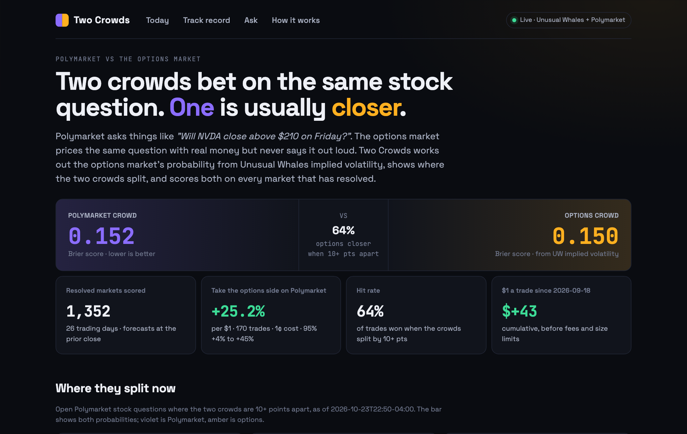
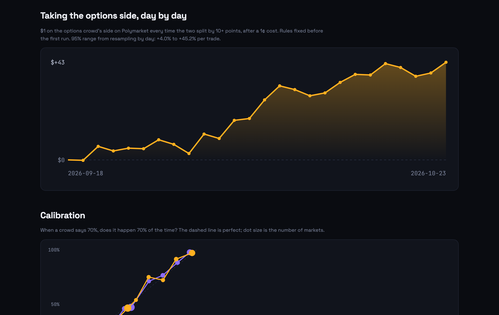
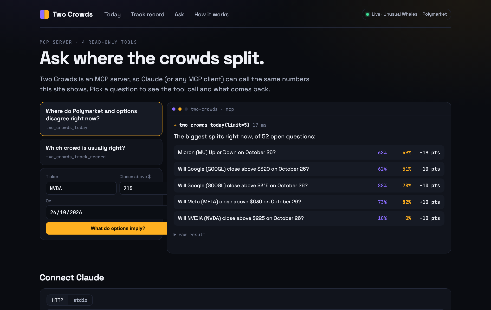
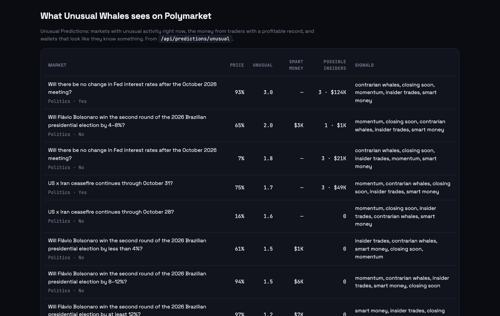

# Two Crowds — does Polymarket or the options market see the close better?

> **TL;DR** · On 1,352 resolved Polymarket stock questions, the probability implied by options (from Unusual Whales
> implied volatility) forecast slightly better than Polymarket's own price. When the two disagreed by 10+ points,
> options were closer 64% of the time, and taking the options side on Polymarket returned about **+25% per $1**.
>
> [Open the live site](https://two-crowds.onrender.com) · [Watch the 80-second demo](https://youtu.be/bvo6ilc_MNg) ·
> MCP endpoint `https://two-crowds.onrender.com/mcp-server/mcp`

<sub>Free hosting: after 15 idle minutes the first visit takes up to a minute to wake the server.</sub>

---

### 1 · The question

Every trading day Polymarket lists ladders like *"Will NVIDIA (NVDA) close above $210 on October 23?"* and
*"Micron (MU) Up or Down on October 23?"*. Thousands of people bet on them.

The options market prices the very same events: a stock closing above a level by a date is exactly what calls
pay out on. It just never prints the answer as a percentage. Two Crowds does, and then asks which crowd was closer.

### 2 · The method

**Both forecasts at the same instant.** For each market we take 4pm New York on the trading day before it resolves:

| Crowd | Forecast | Source |
| --- | --- | --- |
| Prediction market | last traded "Yes" price | Polymarket public API (price history) |
| Options market | `N(d2)`, with `d2 = (ln(S/K) − σ²T/2) / (σ√T)` | close *S* from `/api/stock/{t}/ohlc/1d`; σ from `/api/stock/{t}/interpolated-iv`, interpolated in variance to the horizon *T* |

"Up or Down" questions use the prior close as *K*. Earnings-beat questions can't be priced from options, so they are
shown next to the options flow instead of being scored.

**Scoring.** Each forecast gets a [Brier score](https://en.wikipedia.org/wiki/Brier_score) (0 is perfect, 0.25 is a
coin flip). The trading test was fixed before the first run: when the crowds split by 10+ points, stake $1 on the
options crowd's side at Polymarket's price plus 1¢.

### 3 · The result



| 1,352 markets · 26 trading days (Sep 18 – Oct 23, 2026) | Polymarket | Options |
| --- | :---: | :---: |
| Brier score | 0.152 | **0.150** |
| Closer when 10+ points apart | 62 / 170 | **108 / 170** |
| Closer when 20+ points apart | 9 / 44 | **35 / 44** |



Taking the options side: **+25% per $1** over 170 trades, 64% won. Resampling whole days (strikes on one day move
together), the 95% range is **+4% to +45%**. It survives only using markets that traded in the last hour before the
close (1,300 of 1,352), and a 2–3¢ cost.

**Read it carefully:** the average leans on a few big wins (without the top 10 it is +2.5%, the median trade is still
about +24%); 26 days is short; Polymarket fees and fill size are ignored; σ is at the money, so far strikes carry skew
the model leaves out.

### 4 · Try it

| | |
| --- | --- |
| **Website** | [two-crowds.onrender.com](https://two-crowds.onrender.com): today's splits, the track record, and Unusual Whales' view of Polymarket |
| **Claude / any MCP client** | `claude mcp add --transport http two-crowds https://two-crowds.onrender.com/mcp-server/mcp` |
| **JSON** | `/api/today`, `/api/record`, `/api/market/{id}`, `/api/implied?ticker=NVDA&level=215&date=YYYY-MM-DD`, `/api/status` |
| **Your machine** | see *Run it yourself* below |



MCP tools (read-only): `two_crowds_today` · `two_crowds_track_record` · `implied_probability` · `two_crowds_market`,
plus the prompt `where_do_the_crowds_disagree`. `skill/SKILL.md` is a Claude skill that pairs them with the Unusual
Whales MCP server for live flow and prediction-market data.

### 5 · What Unusual Whales adds



- **Unusual Predictions**: `/api/predictions/unusual` (unusual score, smart-money volume, possible insider wallets,
  tags) with `/api/predictions/smart-money`, `/api/predictions/insiders`, `/api/predictions/market/{asset_id}`
- **The options view**: `/api/stock/{t}/interpolated-iv` (today and past dates), `/api/stock/{t}/ohlc/1d`
- **Which way big bets lean**: `/api/option-trades/flow-alerts`, counting only premium bought at the ask
- **Live context in Claude**: the Unusual Whales MCP server

### Run it yourself

```bash
python3 -m venv .venv && .venv/bin/pip install -r requirements.txt
cp .env.example .env                         # UW_API_KEY=… or leave empty for the saved run
.venv/bin/python -m twocrowds.cli backtest   # rebuild the track record (cached, safe to rerun)
.venv/bin/python -m twocrowds.cli serve      # http://127.0.0.1:8040
```

`today`, `record`, `export-demo` and `mcp` (stdio) are the other commands; `.venv/bin/python -m pytest` runs the tests.
To host: any Docker host. On Render, *New → Blueprint* reads `render.yaml`; set `UW_API_KEY` and `PUBLIC_HOSTS` (the
app's host name, so the MCP endpoint accepts it). Pages never wait on the APIs: the live board refreshes in the
background and the saved run fills in until it's ready.

### FAQ

**Why not just use the options' delta?** Delta is close to N(d1), not the probability of finishing above the strike;
N(d2) is the risk-neutral probability itself.

**Isn't this one-sided?** Both crowds are scored identically, at the same moment, on the same outcomes. If Polymarket
had been closer, the scoreboard would say so.

**Is it a trading signal?** It's a research tool with a short record. Treat the +25% as a reason to keep watching, not
to bet.

---

Code under the [MIT license](LICENSE). Data belongs to its providers: Unusual Whales under your own key and its terms,
Polymarket through its public API. Not financial advice.
