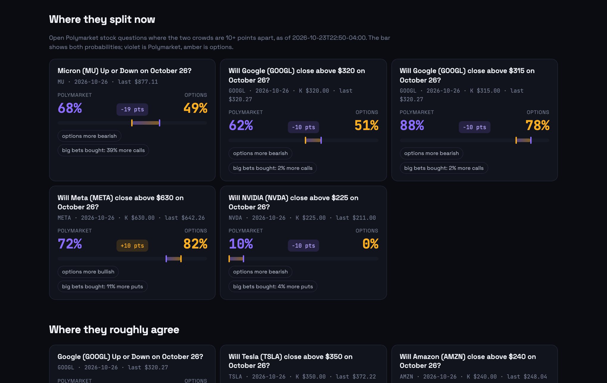

# Two Crowds

**Polymarket says one thing. The options market says another. Who's right?**

▶ **Demo video (1:20): [youtu.be/bvo6ilc_MNg](https://youtu.be/bvo6ilc_MNg)**


Every day Polymarket lists questions like *Will NVIDIA (NVDA) close above $210 on October 23?* and
*Micron (MU) Up or Down on October 23?*. The options market answers the same questions with real money, it just
doesn't say so out loud. Two Crowds works out the options market's probability for each Polymarket question, using
Unusual Whales implied volatility, shows where the two crowds disagree, and keeps a scored record of which one was right.

- **Today:** every open Polymarket stock question priced by both crowds, biggest disagreements first, with Unusual
  Whales' Unusual Predictions flags (smart money, possible insiders, contrarian whales) and which way big bought options
  bets lean on the stock.
- **Track record:** every resolved market, both forecasts taken at the same moment (4pm New York the trading day
  before), scored with the Brier score, plus a calibration chart and a simple test: when the crowds disagree by 10+
  points, does buying the options crowd's side on Polymarket pay?
## What the record shows so far

1,352 resolved Polymarket questions on 26 trading days (Sep 18 – Oct 23, 2026), mostly daily close-above ladders on
NVDA, TSLA, META, GOOGL, AMZN, MSFT and AAPL, plus up/down markets. Both forecasts taken at 4pm New York the day before.

| | Polymarket | Options (from UW implied volatility) |
| --- | --- | --- |
| Brier score (lower is better) | 0.152 | **0.150** |
| Closer to the outcome when they disagreed by 10+ points | 62 of 170 | **108 of 170 (64%)** |
| Closer when they disagreed by 20+ points | 9 of 44 | **35 of 44 (80%)** |

Buying the options crowd's side on Polymarket whenever the two disagreed by 10+ points returned **+25% per $1 staked**
over 170 trades after a 1¢ cost (64% hit rate). Resampling by day, not by market, the 95% range is +4% to +45%. The
threshold and cost were fixed before the first run. Limits worth knowing: the average leans on a few big wins (without
the 10 largest it is +2.5%, though the typical trade is still +24%), 26 days is a short record, and it ignores
Polymarket fees and how much size you could actually get at those prices. Only markets that traded in the last hour
before the close give the same answer (1,300 of 1,352), so stale prices don't explain it.

- **Ask Claude:** an MCP server (four read-only tools, one prompt) and a Claude skill that also uses the Unusual Whales
  MCP server for live flow and prediction-market data.

## Screenshots

| | |
| --- | --- |
|  |  |
| **Where they split now**: both crowds on every open question | **Track record**: taking the options side, day by day |
|  |  |
| **Unusual Predictions**: what Unusual Whales sees on Polymarket | **Ask**: the MCP tools, run from the page |

## How the options probability works

Options are priced on a model where the chance a stock closes above a level K is `N(d2)`,
`d2 = (ln(S/K) − σ²T/2) / (σ√T)`: S is the price, T the time left in trading years, σ the implied volatility for that
horizon. Two Crowds reads σ from Unusual Whales (`/api/stock/{ticker}/interpolated-iv`, interpolated in variance to
the market's horizon) and S from `/api/stock/{ticker}/ohlc/1d`. "Up or Down" questions use the prior close as K.
Earnings-beat questions can't be priced from options, so those cards show Polymarket's odds next to the options flow.

## Unusual Whales data used

| Endpoint | For |
| --- | --- |
| `/api/predictions/unusual` | Unusual Predictions flags on each Polymarket question: score, smart-money volume, insider wallets, tags |
| `/api/predictions/market/{asset_id}`, `/api/predictions/smart-money`, `/api/predictions/insiders` | Market detail and wallet-level context |
| `/api/stock/{ticker}/interpolated-iv` | Implied volatility by horizon, today and on past dates (for the backtest) |
| `/api/stock/{ticker}/ohlc/1d` | Closing prices |
| `/api/option-trades/flow-alerts` | Big options bets bought at the ask (calls vs puts) |
| UW MCP server | Live context in the Claude skill |

Polymarket's public APIs (no key) supply the questions, prices and price history.

## Run it

```bash
python3 -m venv .venv && .venv/bin/pip install -r requirements.txt
cp .env.example .env            # add UW_API_KEY, or leave it empty for demo mode
.venv/bin/python -m twocrowds.cli backtest     # score resolved markets (cached, safe to rerun)
.venv/bin/python -m twocrowds.cli serve        # http://127.0.0.1:8040
```

Other commands: `today` (print the board), `record` (print the score), `export-demo` (save the current data as the
demo dataset), `mcp` (MCP server over stdio). Tests: `.venv/bin/python -m pytest`.

With no key the app runs in demo mode from `data/demo.json`, a saved real run, and makes no network calls.

## Host it

Any host that runs a Docker container works (Render, Railway, Fly.io). On Render: New → Blueprint → this repo (it reads
`render.yaml`), then set `UW_API_KEY` and `PUBLIC_HOSTS` (your app's host name, for example `two-crowds.onrender.com`,
so the MCP endpoint accepts it). The server refreshes the live board in the background every 10 minutes, so pages load
instantly. Until you run `python -m twocrowds.cli backtest` on the host, the track record shows the saved run in
`data/demo.json`.

```bash
docker build -t two-crowds . && docker run -p 8040:8040 -e UW_API_KEY=... two-crowds
```

## Use it from Claude

```bash
claude mcp add --transport http two-crowds https://<your-host>/mcp-server/mcp    # hosted, or http://127.0.0.1:8040/... locally
claude mcp add two-crowds -- .venv/bin/python -m twocrowds.cli mcp              # or over stdio
```

Tools: `two_crowds_today`, `two_crowds_market`, `two_crowds_track_record`, `implied_probability`. Prompt:
`where_do_the_crowds_disagree`. The skill in `skill/SKILL.md` tells Claude how to combine them with the Unusual Whales
MCP server.

## Limits

- At-the-money implied volatility: strikes far from the price carry skew this ignores.
- Strikes on the same day move together, so the real sample size is the number of days.
- Polymarket prices are hourly last trades and some ladders are thin.
- Research, not trading advice.

## Layout

```
twocrowds/uw.py           Unusual Whales client (predictions, IV, prices, flow)
twocrowds/polymarket.py   Polymarket public APIs (questions, prices, history)
twocrowds/parse.py        question text -> ticker, level, date
twocrowds/implied.py      options-implied probability, Brier score
twocrowds/backtest.py     both crowds on resolved markets, the gap trade, calibration
twocrowds/live.py         today's board
twocrowds/web.py          dashboard, JSON API (/api/today, /api/record, /api/market/{id}, /api/implied), MCP at /mcp-server/mcp
twocrowds/mcp_server.py   MCP tools and prompt
skill/SKILL.md            Claude skill
```
